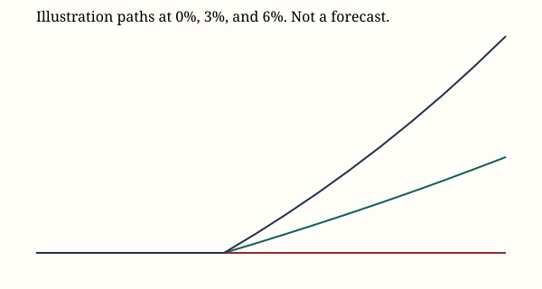
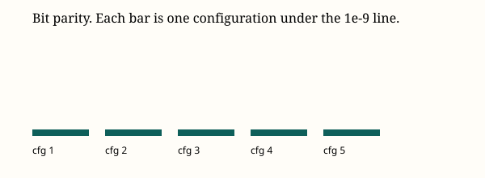

# Methods for the Gao modeling toolkit

This note describes the engine, the generator, the estimators, and the checks. It is a methods note for a team that is exploring a case. It is not an investment recommendation, and it does not contain a portfolio.

## The decision the model is built around

Two contributions arrive at the beginning of 2027 ($300,000) and the beginning of 2028 ($150,000). At the beginning of 2033 a reserve is carved for ten nominal payments of $50,000, one each year from 2033 through 2042. Whatever the active facility rule leaves can be described as a gift. A communication range is attached to 2031. WInS trading uses a separate $300,000 and does not enter the projection.

On a zero-return path with no costs, beginning-of-2033 wealth is $450,000. A zero-yield annuity due of the ten payments is $500,000. Those two identities are locked in Bend and in the golden file.

## The year step

Each year charges the contribution, rebalances from the drifted weights to the policy, records wealth, and then earns the return. The terminal date, the beginning of 2042, records wealth and does not earn a return. Rebalance cost is half the L1 distance between drifted and policy weights, times the round-trip cost in basis points, and it is capped at the whole book. The contribution pays that round-trip rate once.

The same function serves the main path, comparison mixes, and the two-year continuation that produces the 2031 range. The continuation anchors on one wealth, not on each trial's own balances, unless the team selects that source. Common random numbers follow from the counter-based generator: two mixes that share a seed share the shocks.

## The generator

Uniforms and normals come from SplitMix64 keyed by seed, stream, trial, year, and dimension. The uniform uses the top 53 bits and stays inside (0, 1). Normals are Box–Muller pairs. The audit word for seed 42, stream 1, trial 0, year 2027, dimension 0 is fixed and checked by the Python kernel and by the tests.

An earlier analysis harness used a NumPy Philox generator. That generator is a different engine. It has been removed from the portfolio path. The Python file that remains is the year step above, plus three bond helpers that the parity checker still extracts by name. Optional overlays (a Markov drag, a shared Student-t scale, sector and currency shocks, an investment-grade spread, issuer default tied to equity, target-maturity duration, and a binned 2031 range) sit behind flags. The flags are off unless the team turns them on, and the report labels them as overlays.

## Estimators

Volatility is the sample standard deviation with n − 1, annualized by the square root of the number of periods in a year. Beta is an OLS slope with the usual residual standard error. Correlation is Pearson. Drawdown is the peak-to-trough drop of a price index, and of a unit NAV rebuilt from time-weighted returns. The Sharpe ratio subtracts the cash yield and divides by the sample standard deviation. Yield, duration, and spread, when they are quoted from a file, are means of those columns.

A quoted number in an export is recomputed on a one-year daily window, a three-year weekly window, and a five-year monthly window. The citation carries all three, the file name, the SHA-256, the as-of date, and the estimator. A quote outside the cross-window range, or an as-of date more than five weekdays old, is flagged. The tool does not decide which window a memo should have used.

Risk decomposition reports factor and specific volatility, Euler components, the diversification ratio, and Meucci's effective number of bets. A covariance that is not positive semidefinite is clipped and flagged. Brinson allocation, selection, and interaction are reported against a benchmark the team chooses. Tracking error splits into the same two pieces.

The reserve ladder minimizes cost subject to cash-flow or duration coverage, round lots, quoted volume, and the $300,000 capital. Quote richness is the stored quote minus a Nelson–Siegel fair value.

Frontiers (mean-CVaR, a resampled cloud, Black–Litterman, an ellipsoidal worst case) are labeled exploration under the assumptions that were typed. They are not written back as a portfolio.

## Validation

Deterministic parity compares Bend's printed goldens with the TypeScript golden lines, including the locked cash flows and the SplitMix word. Distributional parity compares a 200-trial parametric book with the Python cross-check. Bit parity compares twenty golden configurations and five richer ones with `reference/python/kernel.py`. The richer set checks p5, p50, p95, the funded frequency, and the gift within three standard errors.

Property checks cover cost monotonicity, crash monotonicity, the identity of two runs that share a seed, the reserve present value at a flat yield, and positive semidefiniteness after a covariance repair. VaR exceptions on the risk screen use Kupiec and Christoffersen coverage, and a probability-integral transform, for the monthly Student-t method and for the EWMA Student-t method. Those tests describe a history the team imported. They do not accept or reject a strategy.

The priced path with five mixes and 20,000 trials is timed against a three-second budget. The median of that run is a regression lock. A speedup that moves the median is a bug.

## Limitations

The year step is annual. It does not model path-dependent taxes beyond a single gain-tax rate, and that rate defaults to zero. The ladder's constructive solver is optimal for zero-coupon instruments and approximate for coupon bonds. Black–Litterman and the resampled cloud are only as good as the covariance and the views the team types. Scenario rows are either a cited historical move or a hypothetical labeled as such. None of them is a probability. The Markov fit is a quantile partition of the series the team supplies, with multinomial standard errors, not a filtered regime probability from a longer model.

## References

Nelson, C. R. and Siegel, A. F. (1987). Parsimonious modeling of yield curves. Journal of Business, 60(4).

Black, F. and Litterman, R. (1992). Global portfolio optimization. Financial Analysts Journal, 48(5).

Michaud, R. (1998). Efficient Asset Management. Harvard Business School Press.

Meucci, A. (2009). Managing diversification. Risk, 22(5).

Brinson, G. P., Hood, L. R., and Beebower, G. L. (1986). Determinants of portfolio performance. Financial Analysts Journal, 42(4).

Kupiec, P. (1995). Techniques for verifying the accuracy of risk measurement models. Journal of Derivatives, 3(2).

Christoffersen, P. (1998). Evaluating interval forecasts. International Economic Review, 39(4).

RiskMetrics (1996). Technical document. J.P. Morgan.

Ken French's data library, and the US Treasury par yield curve, as fetched into `data/` and logged in `data/PROVENANCE.md`.
